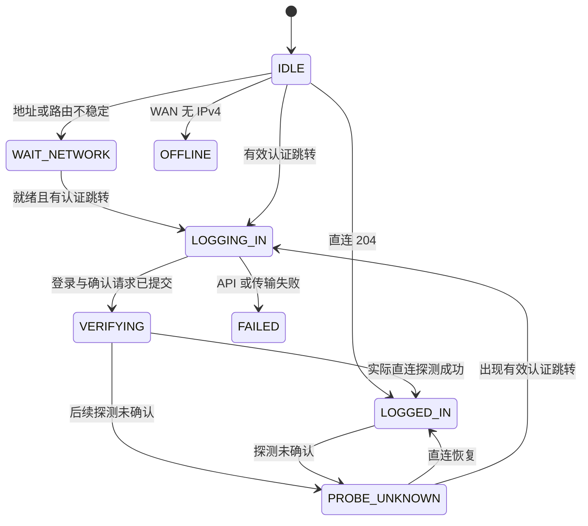

# Portal Loginer 开发者说明

本文对应 1.4.0 代码，供开发和维护使用。内部审查见 [开发记录](docs/development/REVIEW.md)，旧实现以 Git 历史为准。

## 1. 文件与职责

| 文件 | 职责 |
|---|---|
| `/usr/bin/portal-login` | 配置读取、WAN 就绪、探测、认证、状态机与 CLI |
| `/usr/libexec/rpcd/portal-login` | LuCI RPC、JSON 序列化、配置验证、服务操作 |
| `/etc/init.d/portal-login` | procd 生命周期、UCI reload trigger |
| `/etc/hotplug.d/iface/99-portal-login` | WAN ifup 后检查守护进程，未运行时启动 |
| `/etc/config/portal_login` | 账号及选项，600 权限，属于 conffiles |
| `/www/luci-static/resources/view/portal-login.js` | 状态、设置、操作和日志面板 |
| `src/usr/share/{luci/menu.d,rpcd/acl.d}/…` | 菜单与权限注册 |
| `build.sh` | 构建 ipk；固定共享目录 755、执行文件 755、账号配置 600 |
| `install-upgrade.sh` | 为旧包升级保存、恢复现场配置及启动状态 |

运行时文件：`/tmp/portal-login.status`、`/tmp/portal-login.log`、`/tmp/portal-login.cookies`、`/var/run/portal-login.pid`。
事务锁为 `/var/lock/portal-login.lock`，守护进程单实例锁使用同一路径的 `.daemon` 后缀。

## 2. 网络分层与冷启动

PortalLogin 的认证请求必须能在代理不可用时运行。它不接管 DHCP、默认路由或 OpenClash 的生命周期。

`_get_wan_ip()` 优先调用 `network.interface.wan` 的 ubus 状态：要求 `up=true` 并取得实际 `ipv4-address`。
旧系统没有该接口工具时才回退到明确配置的 WAN device/ifname，不能猜测 eth1 或使用 LAN 地址。

地址存在后，检查从该地址到外部地址的 IPv4 路由。地址变化或路由未就绪时清除旧 cookie，等待约 10 秒稳定期。
若缓存 clientip 不匹配新 WAN，清除运行时旧 host/bras/VLAN 等会话参数，等待 AC 给出当前参数，不把旧 bras/VLAN 机械套到新地址。

未拿到地址或路由时不会发送登录 API；定期记录 WAN up/pending、DHCP server、租期、默认路由和 DNS 信息，最多约每分钟一次。
不会自动重启路由器、执行 ifdown/ifup 或基于单次超时强制 DHCP 续租。错发地址、上级光猫未就绪等真实根因需要现场日志验证。

## 3. 探测与状态机

每轮顺序：自定义主探针 → 华为备用 → vivo 备用。任一探针返回可靠结论即停止本轮。
curl 使用 IPv4、禁用显式代理、禁止自动跟随跳转，并限制连接和总时长。

`probe_portal()` 内部返回：

| 值 | 含义 | 守护进程行为 |
|---|---|---|
| 0 | 有效认证重定向 | 进行一次认证事务 |
| 1 | HTTP 204 且传输成功 | 在线，不重复登录 |
| 2 | WAN 无 IPv4 | 等待 DHCP/上级网络 |
| 3 | 未确认或独立通道不正确 | 保留会话，继续探测 |
| 4 | 有地址但无出口路由 | 等待网络就绪 |

HTTP 200、5xx、传输超时、普通网页跳转都不单独证明在线或认证失效。
认证跳转支持 301/302/303/307/308，必须解析出本协议所需参数，通过 host、字符集和当前 WAN clientip 检查。
当前适配内网 IPv4 Portal 服务；不向普通公网重定向发送账号凭据。更换校园认证协议、域名门户或参数格式需单独适配，不能降低校验后直接使用。

主要状态：

图中的 `LOGGED_IN` 表示探测已确认网络在线，不承诺所有目的地址、所有 LAN 设备或代理节点均可用。用户设备联网验收单独记录。

## 4. 校园认证协议

从 AC 重定向 URL 获得 host、bras、clientip、wlanuserip、wlanacname、clientmac、paip、vlan。
同一组有效参数未变化时不重复提交 UCI，减少闪存写入。

1. GET 门户页面建立 cookie。
2. POST `/api/login.php`，按原协议提交 user、加密密码及固定字段。
3. POST `/api/ack_auth.php` 并检查传输和 JSON ret。
4. 再请求直连探针，实际 204 后才记录登录时间、清零失败并标记在线。

登录 ret 的兼容成功值保持为 `0/121/122/3`；确认接口 ret=0 表示接口确认。
如果确认接口异常但直连已实际恢复，记录警告并标记在线；接口成功但联网未确认时保持 VERIFYING，不能仅按 API 响应显示成功。
错误 ret、畸形 JSON、HTTP 错误和传输失败会显示 FAILED，并按设置的初始间隔倍增重试，最多等待 300 秒。

密码加密保持既有校园协议：4 字节随机前缀 + 密码 + 零填充到 16 字节倍数，AES-128-ECB，输出十六进制。
保留已有 32 位字母数字 token 的兼容处理。密钥自动识别只接受明确的 `Utf8.parse("16位密钥")` 文字，不能把任意 16 位字符串覆盖进配置。
该校园协议使用 HTTP，不是端到端 HTTPS 认证；文件权限和 AES 兼容处理不能替代传输加密。

主动登出只用于明确的手动/定时重新认证，要求会话参数仍匹配当前 WAN。重启服务不主动登出。
无法确认网络状态时取消主动登出。每日重登录可设 -1 禁用；升级保留用户原值。

## 5. 并发与状态文件

守护进程和手动 login/relogin/probe 共用 flock 事务锁；休眠前释放。守护进程另持有单实例锁。
关闭文件描述符释放锁，不删除锁文件，防止不同进程锁住不同 inode。退出及进程被终止后由内核释放锁。
启动失败的第二个守护进程不得覆盖第一个进程的状态；PID 检查同时验证 `/proc/PID/cmdline`，避免仅凭 PID 复用误判。

状态更新先写 mktemp 文件，再原子替换；服务器字符串不参与 sed 指令展开。
rpcd get_status 只读取状态，并据实际进程计算 running/STOPPED，不写回主程序状态文件。
账号密码不写入状态文件；日志可能包含账号、内网地址和服务器错误信息，应按现场敏感资料保留。

## 6. OpenClash 探针绕过

`direct_tos` 留空时使用系统出口；配置为 168 时，curl 的 IPv4 TOS=168，对应 DSCP=42、ECN=0。
OpenClash 原生来源流量控制按 root UID + DSCP42，在 OUTPUT 代理链顶部 RETURN，绕过 REDIRECT/TPROXY/TUN 标记。
规则备注使用 `PortalLogin_Direct_42`。插件检查当前代理链中的 UID、DSCP、RETURN 和备注，缺失或不匹配时拒绝借代理探测。
OpenClash 停止且代理链不存在时，自身请求正常直接发出。该集成已在本次设备的 Fake-IP 非 TUN 路径测试；其他固件和传输模式需要验证实际规则。

DNS 同样要独立：第二 DNS 为三个探针域名返回真实地址，其上游 IP 也需在本机绕过地址中。
配置列表以外的自定义探针可能得到 Fake-IP，因此兼容模式下配置保存会先检查域名是否在独立 DNS 列表。
这些规则由 OpenClash 自身重建，不修改订阅、模板或内核文件。

运维 DNS 例外仅涉及列明的域名。外网浏览域名如何加密解析、是否经代理及 LAN DNS 劫持属于 OpenClash 的另外一层配置，不能把探针例外称为全局零 DNS 泄漏。

## 7. UCI 与 LuCI

配置节为 `portal_login.main`，类型 `portal-login`。

| 选项 | 默认 | 校验/作用 |
|---|---|---|
| enabled | 1 | 0/1；服务启动开关，面板保存同步 init 启动项 |
| user / pass | 空 | 账号/密码；面板空密码保留已有值 |
| key | 项目默认密钥 | 16 位 ASCII 字母数字；空值保留 |
| probe_url | 小米 generate_204 | HTTP 204 主探针；兼容模式下还要注册独立 DNS |
| check_interval | 30 | 5–600 秒 |
| retry_interval | 10 | 3–300 秒；认证失败退避上限 300 |
| relogin_hour | 4 | -1 或 0–23；原设置升级保留 |
| log_max | 500 | 50–5000 |
| debug | 0 | 0/1 |
| direct_tos | 空 | 可选 OpenClash 集成值 168；页面只在检测到 OpenClash 时提醒并链接文档，不增加“通道”显示或选择器 |
| last_* | 自动 | 缓存门户参数，使用前检查当前 WAN，不能充当认证失效证据 |

rpcd 方法：get_status、get_logs(lines)、get_config、set_config、do_action(action)。
JSON 使用系统 jshn 解析/序列化；缺失或畸形数字不会生成无效 JSON。
配置先完整校验，再用私有 UCI savedir 提交；密码不写临时 JSON 文件。返回空密码表示保留原值，不提供读取密码的 API。
异步操作返回“已提交”，最终结果以状态和日志为准。重启按钮只 restart，不附加 relogin。

## 8. 安装与测试

构建不得继承调用者的 umask 077 作为共享目录权限。包内目录固定 755、脚本 755、账号配置 600。
`conffiles` 声明 `/etc/config/portal_login`。旧 1.3 的配置保护和升级启停行为不同，因此使用 install-upgrade.sh 保存现场状态。
固件 BusyBox 必须提供 flock；若没有，安装相应固件提供的工具。不能在命令缺失时退回无锁认证。

隔离测试：

- core.sh：探针、认证、WAN/参数、状态写入、配置范围与通道规则。
- rpc.sh：真实 jshn/jsonfilter/UCI 下的 JSON、只读状态、整体验证、保留密码和启动项操作；使用私有配置与 init 替身。
- locking.sh：真实 flock 的并发、描述符关闭、inode 和进程退出。
- daemon.sh：受控时钟下无地址→无路由→稳定→一次认证→在线不重复认证。
- package.sh：umask077 下构建、共享目录、配置权限、conffiles、脚本模式和语法。

本地 Node 仅用于 Windows 离线测试的 JSON 解析替身，不进入安装包。设备端使用真实系统 JSON 工具。
模拟通过不代替真实认证、冷启动、LAN 透明转发和游戏场景验收。每次现场验证记录版本、环境、操作、观察结果与限制，见 docs/development/REVIEW.md。

## 9. 开机校时与耗时

WAN 稳定等待和诊断限频使用 `/proc/uptime` 的开机秒数，不能使用可能因 NTP 跳变的墙上时间。
成功认证时同时保存 `LOGIN_UPTIME`；面板据此计算在线时长，再结合当前系统时间换算登录时间。旧版本未记录该字段时保留旧时间记录，不能事后伪造精确时间。
日志同时记录当时系统时间和 `[up=…s]`，便于将校时前后的事件按开机经过时间对齐。
单纯联网探测成功但未发生认证时，不虚构“上次登录”时间。重启守护进程保留同次开机的已知登录时间。
